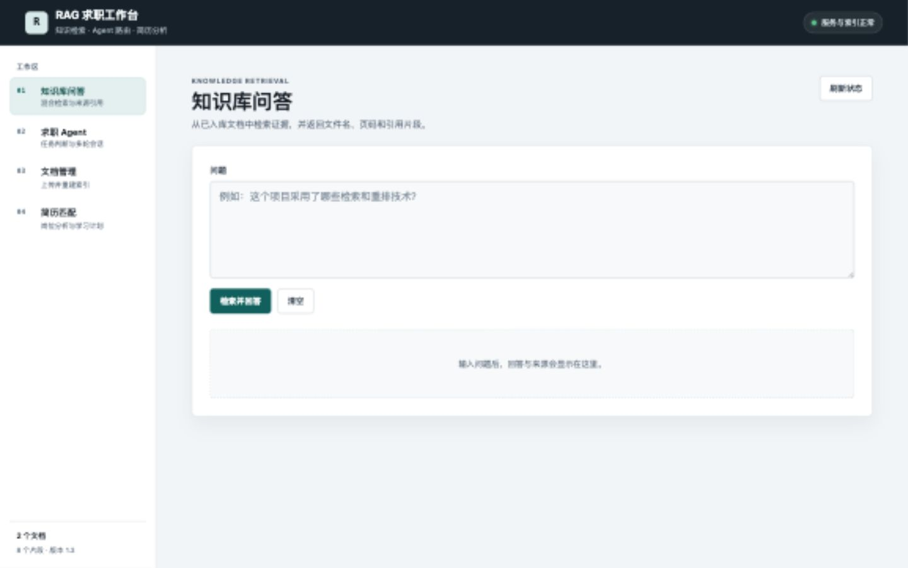

# RAG + Agent 智能求职助手

[](https://github.com/ky-river/rag-demo/actions/workflows/ci.yml)
[](https://www.python.org/)
[](https://fastapi.tiangolo.com/)
[](https://docs.docker.com/compose/)

一个面向内部知识检索和求职准备的 RAG + Agent 可运行项目。系统支持带来源引用的
文档问答、无依据问题拒答、简历与岗位 JD 匹配、技能缺口分析、学习计划生成和多轮
会话。

项目使用 FastAPI、LangGraph、Chroma、BM25 和通义千问 OpenAI 兼容接口，附带
40 题检索评测、离线回归测试、Docker Compose 和 GitHub Actions。

<p align="center">
  
</p>

<p align="center">
  <a href="docs/assets/mobile.jpg">查看移动端截图</a>
</p>

## 快速启动

```bash
git clone git@github.com:ky-river/rag-demo.git
cd rag-demo
cp .env.example .env
```

在 `.env` 中填写兼容 OpenAI 接口的模型配置，然后执行：

```bash
docker compose up -d --build
docker compose ps
curl -sS http://127.0.0.1:8000/health
```

浏览器打开 `http://127.0.0.1:5501`。完整的启动、验收、停止和排错步骤见
[`docs/runbook.md`](docs/runbook.md)。

## 核心能力

- PDF 知识库问答
- 上传 PDF 后自动解析、切分、向量化，并同步重建 BM25 索引
- Chroma 向量召回与 BM25 词法召回通过加权 RRF 融合
- 可选 ONNX Cross-Encoder 重排，加载或推理失败时自动回退到 RRF
- 回答返回文件名、页码、引用片段和混合检索分数
- 相关性低于阈值时可靠拒答，不返回无关来源
- 简历与岗位 JD 匹配
- 技能缺口分析、简历修改建议和预测面试题
- 根据技能缺口生成 4 周学习计划
- 匹配报告下载
- LangGraph Agent 意图路由：知识库问答、学习计划、简历/JD 匹配
- SQLite 持久化多轮会话

## 技术栈

- Python 3.12+
- FastAPI + Uvicorn
- LangChain
- LangGraph
- Chroma
- rank-bm25
- fastembed + ONNX Runtime
- SQLite
- pypdf
- 通义千问 `qwen-plus`
- 通义千问 `text-embedding-v3`
- 原生 HTML/CSS/JavaScript

## 项目结构

```text
app/                 FastAPI、Agent、检索、索引与模型调用
frontend/            原生 HTML/CSS/JavaScript 工作台
eval/                检索、回答、Agent、工具路由和异常测试
tests/               不依赖外部模型的离线回归测试
docs/                架构、演示脚本、运行手册与界面截图
docker-compose.yml   前后端本地编排
```

## 运行

```bash
cd /Users/orange/Desktop/rag-demo
source .venv/bin/activate
python -m uvicorn app.main:app --reload
```

另开终端启动前端：

```bash
cd /Users/orange/Desktop/rag-demo
python -m http.server 5501 --directory frontend
```

浏览器打开：`http://127.0.0.1:5501`

前端 API 地址在 `frontend/config.js` 中配置。默认自动使用当前访问主机的
`8000` 端口，因此本机和局域网访问都不需要修改代码；使用独立 API 域名时，
将 `apiBaseUrl` 改为正式地址即可。

检查后端和索引状态：

```bash
curl -sS http://127.0.0.1:8000/health
```

返回 `status=ok` 表示 Chroma 与 BM25 的片段数一致，索引可以正常提供服务。

常用本地命令：

```bash
make test
make up
make health
make logs
make down
```

Docker 启动：

```bash
docker compose up --build -d
docker compose ps
```

`docker compose ps` 中后端和前端都应显示为 `healthy`。

架构图、演示脚本和本地运行手册分别位于 `docs/architecture.md`、
`docs/demo-script.md` 与 `docs/runbook.md`。
GitHub Actions 会在提交到 `main` 分支或创建 Pull Request 时运行离线测试，
并使用 `pypi.org` 构建一次 Docker 镜像。

Cross-Encoder 默认关闭。需要更高首位命中率时，可以单独启动一个重排实例：

```bash
ENABLE_RERANK=true \
RERANK_CANDIDATES=4 \
HF_HOME=/Users/orange/Desktop/rag-demo/.cache/huggingface \
python -m uvicorn app.main:app --host 127.0.0.1 --port 8002
```

首次运行会下载 `BAAI/bge-reranker-v2-m3-int8` 模型，后续使用本地缓存。
本地 CPU 重排延迟约 1.3 秒，因此生产环境应使用 GPU、独立重排服务或缓存。

## RAG 流程

```text
PDF 上传 -> PDF 文本解析 -> RecursiveCharacterTextSplitter 切分
-> text-embedding-v3 向量化 -> Chroma 存储
-> 中文 bigram 分词 -> BM25 存储
-> Chroma + BM25 各取 Top 12 -> 加权 RRF 融合 -> 取 Top 4
-> 可选 Cross-Encoder 重排 -> 可靠性过滤
-> 拼接上下文 -> qwen-plus 生成答案与来源
```

## 检索参数

| 参数 | 当前值 |
| --- | --- |
| 切分大小 | 500 字符 |
| 切分重叠 | 50 字符 |
| 向量候选 Top K | 12 |
| BM25 候选 Top K | 12 |
| 最终 Top K | 4 |
| RRF | K=10，向量:BM25 = 1:3 |
| Cross-Encoder 候选数 | 4（可选） |
| 向量相关性阈值 | 0.30 |
| 上传限制 | 10 MB，仅 PDF |

相关性阈值基于当前测试语料校准。更换 Embedding 模型或文档分布后，应重新运行评测。

`/search` 只执行检索，不调用生成模型，适合单独检查召回质量。响应包含
`retrieval_mode`、`latency_ms` 以及每个来源的 `relevance_score`、
`lexical_score`、`hybrid_score` 和 `retrieval_method`。启用重排后还会返回
`reranking.active`、`rerank_score` 和 `pre_rerank_rank`。

## 主要接口

| 方法 | 路径 | 用途 |
| --- | --- | --- |
| `GET` | `/health` | 检查索引完整性、文档数和重排状态 |
| `POST` | `/agent-graph` | LangGraph Agent 主入口 |
| `POST` | `/search` | 混合检索与调试 |
| `POST` | `/upload` | 上传 PDF 并重建双索引 |
| `POST` | `/match` | 简历与岗位 JD 匹配 |
| `POST` | `/study-plan` | 根据技能缺口生成学习计划 |

快速检查检索：

```bash
curl -sS -X POST http://127.0.0.1:8000/search \
  -H "Content-Type: application/json" \
  -d '{"question":"相关性阈值是多少？"}'
```

## Agent 工具调用

当前网页通过 `/agent-graph` 调用 LangGraph 工作流。路由节点使用模型选择工具，
条件边再进入对应的工具节点：

| 用户意图 | 工具 |
| --- | --- |
| 项目技术栈、架构、RAG 流程、知识库问题 | `knowledge_search` |
| 学习路线、技能缺口、如何学习 | `create_study_plan` |
| 简历、岗位、JD、匹配 | `resume_match_guidance` |

响应中的 `routing` 字段区分路由来源：

- `model`：模型主动选择工具。
- `fallback`：模型未选择工具时，由关键词规则回退。

## 评测结果

扩展检索集包含 40 个问题：20 个项目问题、10 个简历问题和 10 个无答案问题。
在相同索引和测试集上对比 RRF 与 4 候选 Cross-Encoder：

| 指标 | RRF 混合检索 | Cross-Encoder 重排 |
| --- | --- | --- |
| Hit@1 | 24/30 | 28/30 |
| Hit@4 | 30/30 | 30/30 |
| MRR | 0.886 | 0.958 |
| 无答案拒答 | 10/10 | 10/10 |
| 平均检索延迟 | 215.96 ms | 1297.01 ms |

重排将首位命中从 80% 提升到 93.3%，但本地 CPU 延迟约为 RRF 的 6 倍，所以保持为
可选能力。项目组首位命中从 18/20 提升到 19/20，简历组从 6/10 提升到 9/10。

完整功能验证结果：

- 回答正确：5/5
- 引用正确：5/5
- Agent 路由：5/5
- Agent 工具选择：5/5
- 模型主动选择工具：5/5
- 异常场景：4/4
- 离线回归测试：8/8

延迟为本地开发环境结果，会随网络、模型服务和机器状态变化。当前评测语料规模较小，
这些数字用于验证检索与重排改动是否有效，不代表生产环境泛化能力。

评测命令：

```bash
python eval/run_retrieval_eval.py \
  --suite extended \
  --api-url http://127.0.0.1:8003/search

RAG_API_BASE_URL=http://127.0.0.1:8002 python eval/run_eval.py
RAG_API_BASE_URL=http://127.0.0.1:8002 python eval/run_agent_eval.py
RAG_API_BASE_URL=http://127.0.0.1:8002 python eval/run_tool_eval.py
RAG_API_BASE_URL=http://127.0.0.1:8002 python eval/run_error_eval.py
```

`run_retrieval_eval.py` 支持 `smoke` 和 `extended` 两套检索集，独立检查检索排名，
不调用生成模型。
`run_eval.py` 同时检查回答正确性和引用证据，要求有答案的问题命中预期文件和关键词，
并要求无答案的问题返回空 `sources`。
`run_tool_eval.py` 会检查 LangGraph 工作流中的工具名称，并单独统计模型主动选择工具的比例。

不调用外部模型的路由回归测试：

```bash
python -m unittest discover -s tests -v
```

旧的 `/agent-tools` 路径保留为兼容别名，会使用同一套 LangGraph 工作流。
旧的 `/agent` 关键词路由也已标记为 deprecated，不再作为网页入口。

## 项目亮点

- 上传后自动重建 Chroma 与 BM25 双索引，避免重复向量累积。
- 使用中文 bigram + 加权 RRF 补齐精确术语召回，扩展集 Hit@4 达到 30/30。
- 用 40 题检索集量化重排收益：Hit@1 从 24/30 提升到 28/30。
- 问答结果带来源，便于核验答案。
- 简历/JD 匹配结果结构化展示，并支持报告下载。
- 对模型输出 JSON 做解析失败兜底。

## 后续计划

- 完善用户登录和数据隔离
- 将索引重建改为临时目录构建成功后再原子替换
- 增加模型请求超时、结构化日志和请求追踪
- 增加重排服务缓存、并发控制和更多领域评测集
- Docker 部署到 Linux 云服务器
