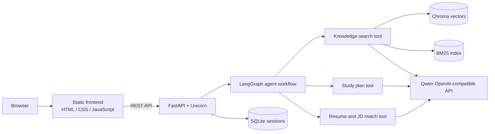
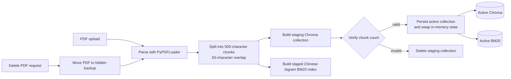
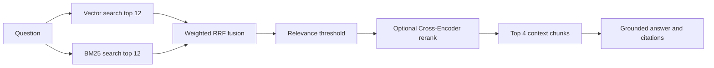
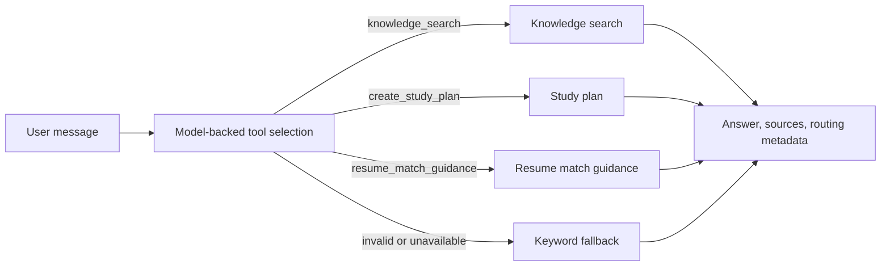
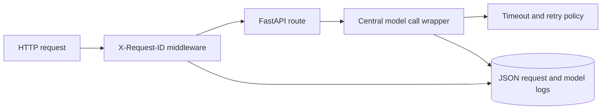

# Architecture

## System Context

## Document Ingestion

The upload endpoint writes the validated PDF to a temporary path, rebuilds both
indexes in a staging collection, checks the stored chunk count, and only then
updates the active collection pointer. A failed rebuild removes the staging
collection and restores the previous PDF instead of damaging the active index.
The delete endpoint follows the same build-and-switch path after moving the PDF
to a hidden backup. A failed rebuild restores the PDF and keeps the old indexes.
The health endpoint verifies that the Chroma collection and BM25 document
counts agree.

## Hybrid Retrieval

If no chunk passes the relevance threshold, the knowledge tool returns the
configured refusal response without calling the generation model.

## Agent Workflow

The current graph is intentionally a bounded single-tool workflow. A future
iteration can add query rewriting, evidence verification, and bounded retry
nodes while keeping the same tool interface.

## Request Observability

Every request receives a validated or generated request ID. JSON logs capture the
method, path, status code, request duration, model operation, model duration, and
error type. A model timeout returns HTTP 504 with the same request ID so operators
can locate the corresponding log entries without exposing model credentials.

## Failure Boundaries

- Model calls are isolated inside the generation and agent-routing helpers.
- Reranker initialization and inference failures fall back to RRF ordering.
- Index rebuilds use staged collections and switch only after count validation.
- Concurrent retrieval waits for the index swap to complete.
- Unsupported, empty, oversized, or unreadable uploads return explicit errors.
- Session history is stored in SQLite with a maximum retained history length.
- `/health` reports collection count, document count, and reranker status.
